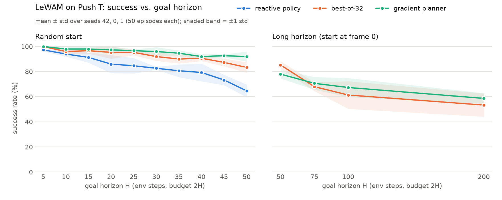

# Push-T: success vs. goal horizon

Goal-reaching success (%) of the released [Push-T checkpoint](https://huggingface.co/LeWAM/lewam-pusht), mean ± std
over seeds 42, 0 and 1 with 50 episodes each. The checkpoint was trained with goals up to `H_max = 10` chunks of
`fs = 5` steps (50 env steps); beyond that the policy's horizon input is clamped at 50. Generated by
`python scripts/plot_horizons.py` from the results in `$STABLEWM_HOME/eval/`.



## Random start

The default protocol ([REPRODUCE.md](../REPRODUCE.md#evaluation)): start at a random step of a dataset episode and
reach the frame H steps later within 2H actions.

```bash
python scripts/eval_lewam.py --config-name pusht policy=lewam-pusht seed=<seed> \
    eval.goal_offset_steps=<H> eval.eval_budget=<2H> <mode overrides>
```

| H (env steps) | budget | reactive policy | best-of-32 | gradient planner |
|---:|---:|---|---|---|
| 5 | 10 | 97.3 ± 1.2 | 100.0 ± 0.0 | 100.0 ± 0.0 |
| 10 | 20 | 94.0 ± 2.0 | 96.0 ± 2.0 | 98.0 ± 2.0 |
| 15 | 30 | 91.3 ± 4.2 | 96.7 ± 2.3 | 98.0 ± 2.0 |
| 20 | 40 | 86.0 ± 7.2 | 95.3 ± 5.0 | 97.3 ± 3.1 |
| 25 | 50 | 84.7 ± 6.1 | 95.3 ± 2.3 | 96.7 ± 1.2 |
| 30 | 60 | 82.7 ± 1.2 | 92.0 ± 3.5 | 96.0 ± 3.5 |
| 35 | 70 | 80.7 ± 5.0 | 90.0 ± 3.5 | 94.7 ± 2.3 |
| 40 | 80 | 79.3 ± 7.0 | 90.7 ± 2.3 | 92.0 ± 2.0 |
| 45 | 90 | 73.3 ± 4.2 | 87.3 ± 3.1 | 92.7 ± 1.2 |
| 50 | 100 | 64.7 ± 5.0 | 83.3 ± 4.2 | 92.0 ± 4.0 |

## Long horizon

Start at frame 0 of episodes at least 101 steps long (and longer than H), replan every 25 actions, goal H steps
ahead, budget 2H. At H = 200 only the 505 episodes longer than 200 steps qualify, so that point is drawn from the
longest demonstrations. Planners only: the reactive policy predicts 10-action chunks, so it cannot execute 25
actions per replan.

```bash
python scripts/eval_lewam.py --config-name pusht policy=lewam-pusht seed=<seed> <mode overrides> \
    eval.random_start=false eval.min_episode_len=101 eval.exec_actions=25 \
    eval.goal_offset_steps=<H> eval.eval_budget=<2H>
```

| H (env steps) | budget | reactive policy | best-of-32 | gradient planner |
|---:|---:|---|---|---|
| 50 | 100 | n/a | 85.3 ± 3.1 | 78.0 ± 3.5 |
| 75 | 150 | n/a | 68.0 ± 3.5 | 70.7 ± 5.0 |
| 100 | 200 | n/a | 61.3 ± 11.0 | 67.3 ± 7.6 |
| 200 | 400 | n/a | 53.3 ± 9.2 | 58.7 ± 4.2 |

Mode overrides: reactive policy `eval.mode=lewam_policy`; best-of-32 `eval.mode=lewam_plan eval.plan_mode=best_of_k`;
gradient planner `eval.mode=lewam_plan eval.plan_mode=grad eval.grad_all_k=true eval.grad_tr=0.01 eval.grad_steps=5`
(plus `eval.exec_actions=5` under random start).
